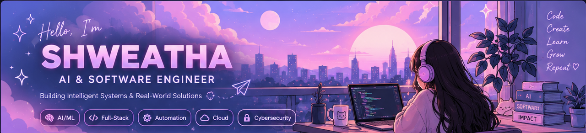
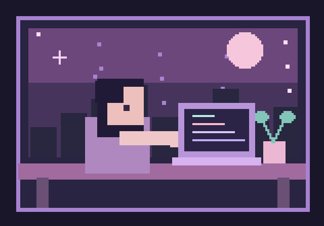

  

  

    
    
    
  

  

## ✨ A little about me

<table>
<tr>
<td width="64%" valign="middle">

Hey, I'm **Shweatha**! 👋

I love seeing an idea turn into something that actually works — whether that's a machine learning model, a full-stack app, or a tiny fix that took way too much debugging.

I build across **AI and software engineering**, and lately I've been exploring **agentic AI, computer vision, and cybersecurity**. I'm happiest when I'm learning something new and getting it to work in the real world.

🌸 [Take a look at my portfolio](https://shweatha-portfolio.vercel.app/)

</td>
<td width="36%" align="center" valign="middle">
  
</td>
</tr>
</table>

  
  
When it works on the first try... I get suspicious. 🐱

## 🧰 Engineering Toolkit

**Languages & Frameworks**

**AI, Machine Learning & Data**

**Cloud, Tools & Databases**

## 📈 GitHub Activity

View my actual GitHub activity and public repositories

## 🐍 My purple contribution snake

  <picture>
    <source media="(prefers-color-scheme: dark)" srcset="https://raw.githubusercontent.com/Shwethabathina/Shwethabathina/output/github-contribution-grid-snake-dark.svg" />
    
  </picture>

## 🌷 Let's Connect

  
  
  

  

  Turning curiosity into what's next ✨

