  
    
  
  
  
    
  

## ✨ A little about me

<table><tr><td width="61%" valign="top">

Hey, I'm **Shweatha**! 👋

I love the part of building software where an idea finally starts working. Sometimes that means training a model, sometimes it's figuring out why a piece of code won't cooperate, and sometimes it's making an interface feel just right.

I work across **AI, machine learning, and software development**, and I'm especially curious about agentic AI, computer vision, and cybersecurity. I like getting into the details, learning as I go, and making things that are actually useful.

When I'm not working through a new idea, I'm probably exploring a tool I just discovered or finding another way to make something better.

🌸 **A closer look at what I do:** [Visit my portfolio](https://shweatha-portfolio.vercel.app/)

</td><td width="39%" valign="top">

</td></tr></table>

## 🧰 Engineering Toolkit

  <strong>Languages & Frameworks</strong>  
    
  <strong>Machine Learning & Data</strong>  
    
  <strong>Cloud, Tools & Databases</strong>  
  

## 📈 GitHub Activity

  
  
    
  

### 🐍 Contribution snake

_The snake appears once the workflow has been added on GitHub and completes successfully._

  <picture>
    <source media="(prefers-color-scheme: dark)" srcset="https://raw.githubusercontent.com/Shwethabathina/Shwethabathina/output/github-contribution-grid-snake-dark.svg" />
    
  </picture>

## 🌷 Let's Connect

  
  
  
    
  
  Turning curiosity into what's next ✨

